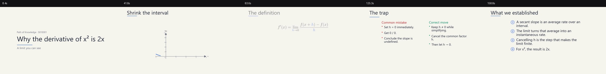

# Manim Math Video Studio

A portable [Agent Skill](https://agentskills.io/specification) for turning a mathematical theme into a storyboarded, narrated Manim video — and into a consistent series.

The agent interviews the user about the **argument**, not just the topic: thesis, audience, crux, chain of claims, misconception, visual evidence, and takeaway. It then locks four production parameters (**quality, voice, language, template**), scaffolds the episode, generates narration with timing, renders graphs and equations, and runs a QA pass.

## What is in this repository

```text
manim-math-video/
├── SKILL.md                     # routing description + workflow instructions
├── references/
│   ├── interview.md             # argument interview question bank
│   ├── brief.md                 # brief schema, defaults, quality presets
│   ├── templates.md             # template catalog and series rules
│   ├── voices.md                # voice/language selection and pronunciation
│   ├── storyboard.md            # beat grammar and pacing
│   ├── graphs.md                # graph specs, annotations, animations
│   ├── manim-recipes.md         # custom beats, 3D, camera, equations
│   ├── series.md                # series registry and consistency
│   ├── accuracy.md              # math verification checklist
│   └── troubleshooting.md       # installation and failure modes
├── assets/
│   ├── templates/               # clean-light, dark-board, paper-editorial
│   ├── project/                 # standalone manim_lib runtime + episode template
│   ├── voices.json              # curated edge-tts voices and styles
│   ├── brief.schema.json
│   ├── storyboard.schema.json
│   ├── brief.example.json
│   └── storyboard.example.json
├── scripts/
│   ├── check_env.py             # dependency diagnostics
│   ├── validate.py              # brief/storyboard/template validation
│   ├── new_episode.py           # scaffold a series episode
│   ├── storyboard_to_script.py  # readable script + duration estimate
│   ├── tts.py                   # edge-tts / Piper / custom / silent
│   ├── render.py                # Manim render + copy + QA
│   ├── qa.py                    # streams, audio, subtitles, contact sheet
│   └── selftest.py              # asset checks + optional smoke render
└── examples/                    # verified demo series source + preview contact sheet
```

## Requirements

- Python 3.10+
- Manim Community 0.19+ (0.22+ recommended)
- `edge-tts` (default narration), or Piper / a custom TTS command
- PyAV (audio conversion and QA) and Pillow (contact sheets)
- A LaTeX distribution for equation beats (`latex` + `dvisvgm`)

```bash
python -m pip install -r requirements.txt   # from the repository root
# or: python -m pip install manim edge-tts av pillow
cd manim-math-video
python scripts/check_env.py
```

## Install LaTeX + dvisvgm

LaTeX is only needed for **equation beats**. Graphs, narration, captions, and titles work without it. Manim uses the `latex` compiler and `dvisvgm` to turn equations into SVG.

### Windows (recommended: MiKTeX)

```powershell
winget install --id MiKTeX.MiKTeX -e --accept-package-agreements --accept-source-agreements
```

Then open **MiKTeX Console** → **Settings** and set **Missing packages** to **Always install missing packages on-the-fly**. Close and reopen the terminal.

Verify:

```powershell
where latex
where dvisvgm
latex --version
dvisvgm --version
```

If `dvisvgm` is missing, install it from MiKTeX Console → **Packages**, or run:

```powershell
mpm --install=dvisvgm
```

Chocolatey alternative: `choco install miktex -y`.

### Windows (lightweight: TinyTeX)

Download the latest **TinyTeX-1 Windows** installer from [rstudio/tinytex-releases](https://github.com/rstudio/tinytex-releases/releases). It is a 7-Zip SFX archive; extract it to a tools directory:

```powershell
TinyTeX-1-windows.exe -y -o C:\tools\TinyTeX
$env:PATH = "C:\tools\TinyTeX\TinyTeX\bin\windows;$env:PATH"
```

Install the common Manim requirements:

```powershell
tlmgr update --self
tlmgr install dvisvgm standalone amsmath amsfonts
# optional broader coverage:
tlmgr install collection-latexrecommended collection-fontsrecommended
```

Add `C:\tools\TinyTeX\TinyTeX\bin\windows` to the persistent **Path** environment variable. If a render reports a missing `.sty` file, install it with `tlmgr install <package-name>`.

### macOS

```bash
brew install --cask mactex-no-gui
# or, for a smaller install:
brew install --cask basictex
sudo tlmgr update --self
sudo tlmgr install dvisvgm standalone amsmath amsfonts
```

### Linux

```bash
# Debian / Ubuntu
sudo apt update
sudo apt install texlive texlive-latex-extra texlive-fonts-recommended dvisvgm

# Fedora
sudo dnf install texlive-scheme-medium dvisvgm

# Arch
sudo pacman -S texlive-basic texlive-latexextra dvisvgm
```

### Verify the installation

```bash
manim checkhealth
```

Both of these should say `PASSED`:

```text
- Checking whether latex is available ... PASSED
- Checking whether dvisvgm is available ... PASSED
```

Then verify the skill environment:

```bash
cd manim-math-video
python scripts/check_env.py
```

`LaTeX` and `dvisvgm` should both show `ok`. More installation and failure notes are in `manim-math-video/references/troubleshooting.md`.

## Install as a Pi skill

Copy or symlink the `manim-math-video` directory into a discovered skills location:

```text
# User-level
~/.pi/agent/skills/manim-math-video/

# Project-level
<project>/.pi/skills/manim-math-video/

# Agent Skills standard
~/.agents/skills/manim-math-video/
```

Then run `/skill:manim-math-video` in Pi, or let the model route to it when the task matches.

## Quick start

```bash
cd manim-math-video

# 1. Check the environment
python scripts/check_env.py

# 2. Scaffold a series + episode from the example brief
python scripts/new_episode.py --brief assets/brief.example.json --series-dir ../my-series

# 3. Fill the storyboard, or copy the demo storyboard
cp assets/storyboard.example.json ../my-series/episodes/001-why-derivative-x-squared/storyboard.json

# 4. Validate, narrate, render a draft
python scripts/validate.py --episode ../my-series/episodes/001-why-derivative-x-squared
python scripts/storyboard_to_script.py --episode ../my-series/episodes/001-why-derivative-x-squared
python scripts/tts.py --episode ../my-series/episodes/001-why-derivative-x-squared
python scripts/render.py --episode ../my-series/episodes/001-why-derivative-x-squared --quality draft
```

## How the pipeline works

1. **Interview** — the agent follows `references/interview.md` and asks for the four required parameters plus the argument core.
2. **Brief** — `brief.json` records the approved thesis, audience, chain, notation, quality, voice, language, and template.
3. **Scaffold** — `new_episode.py` creates a standalone episode with a copied `manim_lib/`, a theme snapshot, and a storyboard skeleton.
4. **Storyboard** — `storyboard.json` has one narration segment per beat and one visual idea per beat.
5. **Narration** — `tts.py` writes `voice/*.wav`, `voice/manifest.json`, and a preview SRT. Edge TTS word boundaries are captured.
6. **Render** — the generated `episode.py` subclasses `StoryboardScene`, which reads the storyboard, theme, and voice manifest, adds sound and captions, and renders graphs and equations.
7. **QA** — `render.py` copies the MP4/SRT and `qa.py` produces a contact sheet, stream report, audio levels, subtitle coverage, and warnings.

## The templates

| Template | Look | Best for |
|---|---|---|
| `clean-light` | warm off-white, ink, cobalt/amber, precise sans | general explainers, graphs, classroom |
| `dark-board` | deep navy, chalk-bright ink, cyan/violet | calculus, analysis, linear algebra, long-form |
| `paper-editorial` | warm paper, serif, oxblood/olive | history/philosophy of math, essays |

A template locks palette, fonts, layout, graph styling, motion, captions, and narrative rhythm. The episode keeps a `theme.json` snapshot so later catalog changes do not silently restyle old videos.

## Verified demo

The `manim-math-video/examples/demo-series` source is a complete 3-minute episode on the derivative of x². It was scaffolded, narrated with edge-tts, rendered at 480p15, and QA'd. See `manim-math-video/examples/README.md` and the preview contact sheet:



## Graph support

The data-driven runtime supports:

- Cartesian plots from safe expressions (`x**2`, `sin(x)/x`, `exp(-x**2)`).
- Parametric curves.
- Data series and bar charts.
- Vector fields.
- Annotations: points, text, vertical/horizontal lines, tangents, secants, areas, Riemann rectangles, braces, arrows, slope triangles, derivatives.
- Animations: draw, sweep, secant-to-tangent, Riemann refinement, area reveal.
- 3D surfaces via a `custom` beat and `ThreeDScene` (recipe included).

## Aspect ratios

`16:9` is the default. The runtime also supports `9:16`, `1:1`, and `4:3` with automatic frame sizing; `render.py` swaps the output dimensions and names the file accordingly. Vertical layouts stack the `compare` columns. Always review a draft contact sheet for overflow and caption fit.

## Narration support

- **edge-tts** (default): many languages, curated voices, style presets, word boundaries.
- **Piper**: offline, local model.
- **Custom command**: ElevenLabs, OpenAI TTS, Azure, or a local model.
- **None**: silent timing draft.

Language and voice are independent of the template. Subtitles can be translated per beat with the `caption` field.

## Series consistency

`series.json` locks the template, quality, language, voice, title grammar, and narrative rhythm. `new_episode.py` refuses style drift unless `--allow-style-drift "reason"` is passed. See `references/series.md`.

## Validation

```bash
python scripts/validate.py --brief brief.json
python scripts/validate.py --episode path/to/episode
python scripts/validate.py --template assets/templates/dark-board.json
```

Validation checks required fields, template existence, quality, voice/locale compatibility, beat IDs, graph expressions, annotation types, equation/LaTeX availability, duration drift, and the voice manifest.

## License

MIT. See `LICENSE`.

## Notes

- This project is not affiliated with Manim Community or Microsoft edge-tts.
- The `dark-board` template is an original visual style, not a reproduction of any existing channel's branding.
- Always verify the mathematics and the rights to images, music, fonts, and quotations.
