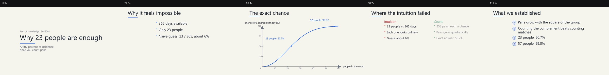
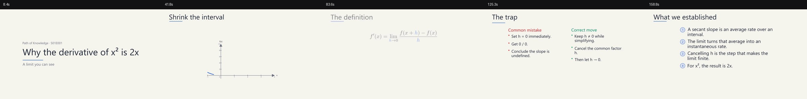

# Example episodes

Two verified episodes (independent example series, each numbered from episode 1),
both rendered end to end from a brief: narration with edge-tts,
Manim render, then QA. Their MP4s, WAVs, and media caches are intentionally not committed —
what you see here is the source, plus one preview image per episode.

## 1. Why 23 people are enough for a shared birthday



`birthday-series/` — the episode used as the README demo. Nine beats, 118 s, 1080p30.

- **Series:** Path of Knowledge · **Episode:** `s01e001`
- **Template:** `clean-light` · **Voice:** `en-US-AvaMultilingualNeural` (`-3%`)
- **Shows:** a `data` graph built from exact probabilities with point annotations, an
  equation beat that explains the curve, and a `compare` beat for the misconception.
- **Result:** 1920x1080 at 30 fps, 29 subtitle cues at 97% coverage, audio peak -4.6 dB,
  QA with no failures or warnings.

```bash
EP=examples/birthday-series/episodes/001-why-23-people-shared-birthday
python scripts/validate.py --episode "$EP"
python scripts/tts.py --episode "$EP"
python scripts/render.py --episode "$EP" --quality draft
```

## 2. Why the derivative of x² is 2x



`demo-series/` — the original 3-minute episode on the limit of secant slopes.

- **Series:** Path of Knowledge · **Episode:** `s01e001`
- **Template:** `clean-light` · **Voice:** `en-US-AvaMultilingualNeural` (`-3%`)
- **Shows:** four graph beats (secants closing onto a tangent), three equation beats, and a
  misconception `compare` — the long-form shape for a derivation.
- **Result:** draft 480p15 rendered and QA'd; ~167 s; 37 subtitle cues at 96% coverage;
  audio peak -5.0 dB, RMS -23.7 dB.

```bash
EP=examples/demo-series/episodes/001-why-derivative-x-squared
python scripts/validate.py --episode "$EP"
python scripts/tts.py --episode "$EP"
python scripts/render.py --episode "$EP" --quality draft
```

## Regenerating a preview contact sheet

```bash
python scripts/qa.py \
  --video examples/birthday-series/episodes/001-why-23-people-shared-birthday/output/*.mp4 \
  --out-dir examples/birthday-series/episodes/001-why-23-people-shared-birthday/qa
```

If LaTeX is not on your `PATH`, either install it (`install.py --with-latex`) or set
`latex_fallback: true` in the brief to render equations as images instead.
